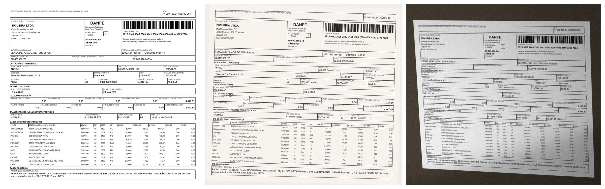

# papelada

**How well do AI models read Brazilian documents — and do they make things up when they can't?**

`papelada` (Portuguese for *paperwork*) is an open benchmark for structured data extraction from Brazilian documents: PIX receipts, invoices (DANFE) and voting bulletins. Models receive a document image and a JSON schema, and must return the data — or `null` when a field isn't there.

Most document benchmarks are English and US-centric. Brazilian paperwork has its own formats (CNPJ, CPF, `R$ 1.234,56`, NF-e access keys, boletim de urna) and its own failure modes. This project measures them.



## Leaderboard

Set `v1`: synthetic PIX receipts, invoices (DANFE) and voting bulletins, each read at three levels — L0 clean render, L1 scan, L2 phone photo. Cells are field accuracy in %. **Score** is the mean over the three document types. Hallucination is the share of absent fields a model filled with something not printed on the page.

<!-- leaderboard:start -->
| Model | Score | PIX L0 / L1 / L2 | DANFE L0 / L1 / L2 | Bulletin L0 / L1 / L2 | Hallucination | US$/doc | Tested |
|---|---|---|---|---|---|---|---|
| `anthropic/claude-haiku-5.5` | **98.5** | 100.0 / 100.0 / 100.0 | 100.0 / 99.8 / 98.8 | 100.0 / 97.5 / 90.5 | 0.0% | 0.0015 | 2026-10-28 |
| `openai/gpt-6-luna` | **98.0** | 98.9 / 98.9 / 98.9 | 99.7 / 99.6 / 88.6 | 99.9 / 99.9 / 97.8 | 0.0% | 0.0011 | 2026-10-28 |
| `qwen/qwen3.8-27b` | **97.1** | 98.9 / 98.9 / 97.4 | 96.9 / 96.5 / 86.1 | 100.0 / 99.0 / 99.9 | 0.0% | 0.0051 | 2026-10-28 |
| `deepseek/deepseek-v4.1-flash-1017` | **96.7** | 99.3 / 100.0 / 99.6 | 99.3 / 98.6 / 88.6 | 99.9 / 99.8 / 85.0 | 0.0% | 0.0025 | 2026-10-28 |
| `minimax/minimax-m3.1-flash` | **95.4** | 99.6 / 98.9 / 98.9 | 99.1 / 97.9 / 83.5 | 98.0 / 92.7 / 89.6 | 0.9% | 0.0034 | 2026-10-28 |
| `xiaomi/mimo-v2.6-flash` | **89.9** | 99.6 / 99.6 / 99.6 | 98.1 / 93.6 / 81.3 | 100.0 / 81.0 / 56.5 | 0.0% | 0.0029 | 2026-10-28 |
| `nvidia/nemotron-3.5-super-vl` | **82.1** | 88.9 / 96.3 / 91.5 | 98.7 / 96.2 / 80.8 | 68.5 / 71.2 / 47.1 | 0.4% | 0.0032 | 2026-10-28 |
<!-- leaderboard:end -->

Scored on the 61 documents every model completed at all three levels (30 invoices, 18 PIX receipts, 13 bulletins); the first run lost some calls to an exhausted API balance, and those are left out rather than counted against the model. New models are added as they ship: each is run once on the same frozen set and scored on the same 61 documents, with the same prompt and scoring, so rows stay comparable. One run per model and a small sample — differences of a point or two are noise. Set `v1` seeds are not published; gold fingerprint `ec7e606612ad33b8`.

What stands out:

- **Clean documents are solved; photos are not.** Every model except Nemotron scores 97–100% on clean renders. On a phone photo of an invoice, all but Claude Haiku 5.5 (98.8%) fall to 81–89%.
- **No model wins everything.** Haiku leads overall but drops to 90.5% on bulletin photos, which Qwen3.8 27B reads almost perfectly (99.9%).
- **Hallucination is rare, but not zero.** On blurry invoices with a blank district box, MiniMax wrote a ZIP-like number into it and invented a nine-digit ZIP; Nemotron filled the same blank with a town name. No other model invented a value.
- **Some failures are not about reading.** MiMo (9 times) and DeepSeek (once) reasoned until they hit 131k output tokens and returned nothing. Nemotron reads bulletins but copies party headers verbatim ("PIA - 74") and appends the party to candidate names, so it fails the format, not the print.
- **Cheapest is near the top:** GPT-6 Luna costs US$ 0.0011 per document and ranks second.

A first look on a smaller, public set (with a closer study of substitution and traps) is in [docs/results-2026-10-28.md](docs/results-2026-10-28.md).

## What it measures

- **Field accuracy** — after normalization, so `123.456.789-09` and `12345678909` are the same CPF.
- **Table accuracy** — cell-level scoring for invoice items and bulletin candidates, with rows paired by content.
- **Hallucination** — the model fills a field that does not exist in the document with something not printed anywhere on it.
- **Misattribution** — the model copies real text from the wrong place: a footer into the description, the payer's CPF into the payee's field.
- **Substitution** — the model could not read a word and wrote a different real word or place instead.
- **Trap accuracy** — text a model is tempted to "fix": uncommon name spellings (Thyago, Uóxinton), homophones (conserto/concerto), typos, slang and ballot nicknames as they are actually printed.
- **Schema validity**, **cost** and **latency** per document.

## How it works

Documents are **synthetic**: rendered from templates with fake but valid data (correct check digits, NF-e access keys, totals and vote counts that add up), then degraded across three levels — clean render, scan, phone photo. Every document is rendered at all three levels, so the effect of degradation is measured on the same content. Synthetic data gives perfect ground truth, keeps personal data out of the dataset, and lets fresh test sets be generated so models can't memorize them.

[`samples/`](samples/) has a few public examples of each document type, with their images, gold JSON and metadata.

Methodology, scoring rules and roadmap: [docs/PLAN.md](docs/PLAN.md). Extraction targets: [`schemas/`](schemas/).

## Open, but not leakable

Everything is reproducible from a seed, so the code alone could regenerate any test set. Published results use seeds that are disclosed with them; future scored sets use undisclosed seeds, and only samples are published. Free (`:free`) model endpoints, which may train on inputs, are never used on a private set.

## Usage

Requires [uv](https://docs.astral.sh/uv/).

```sh
uv sync
uv run papelada generate pix_receipt --n 24 --seed 0 --out data/sample
uv run papelada generate danfe --n 12 --seed 0 --out data/sample
uv run papelada generate voting_bulletin --n 12 --seed 0 --out data/sample
uv run papelada fetch-lexicon   # word and place lists for the substitution metric

# Models are "<provider>:<model id>". Keys come from the environment or a gitignored .env:
# openrouter (OPENROUTER_API_KEY), google (GOOGLE_API_KEY)
uv run papelada run openrouter:deepseek/deepseek-v4.1-flash-1017 --data data/sample
uv run papelada report results/runs/*.jsonl --fields

# Scoring changes can be applied to saved runs without calling models again
uv run papelada rescore results/runs/*.jsonl

# The README table
uv run papelada leaderboard results/runs/*.jsonl --samples scored.txt  # optional: same documents for every model

uv run pytest
```

## Status

Early and opinionated. Three document types, one prompt, one run per model. How sets are frozen and models added: [docs/PLAN.md](docs/PLAN.md#frozen-sets). Planned: repeat runs to measure variance, a handful of real public documents (TSE bulletins) as a realism check, larger samples, more document types (boleto, payslip, receipts), and handwriting.

## Data sources

- Municipalities: [IBGE localities API](https://servicodados.ibge.gov.br/api/docs/localidades), public data, vendored in `src/papelada/data/municipalities.csv`.
- Word frequencies for the substitution metric: [FrequencyWords](https://github.com/hermitdave/FrequencyWords) by Hermit Dave (CC BY-SA 4.0), downloaded on demand, not redistributed.
- Names, companies and streets in generated documents are fake (Faker `pt_BR` and fixed lists). Institutions on PIX receipts, and parties and candidates on voting bulletins, are fictional.

## License

Code under the [MIT License](LICENSE). Generated samples in [`samples/`](samples/) under [CC BY 4.0](https://creativecommons.org/licenses/by/4.0/).
